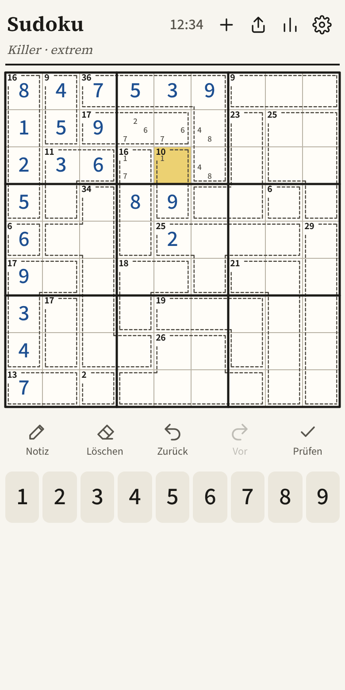
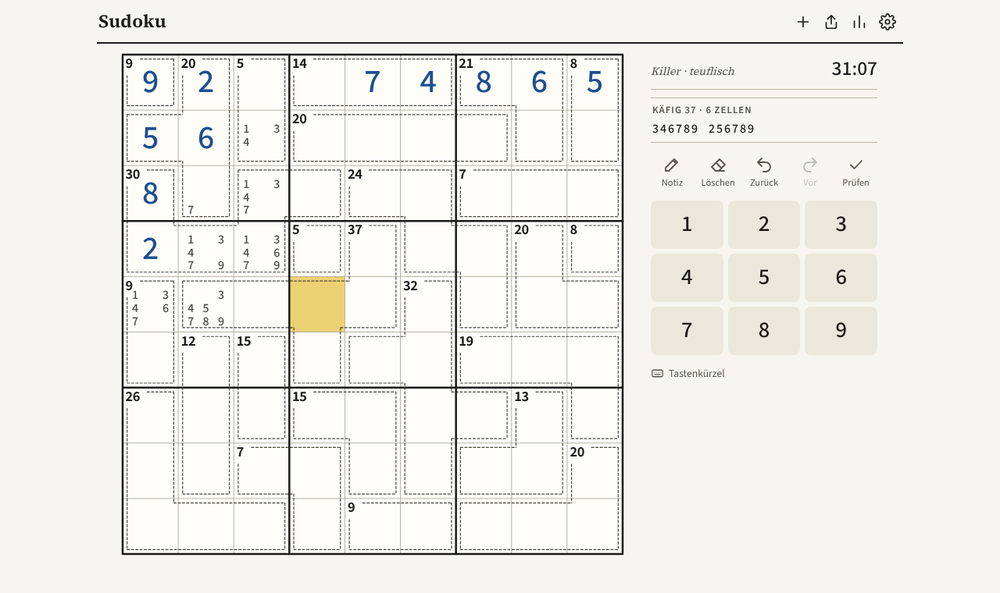
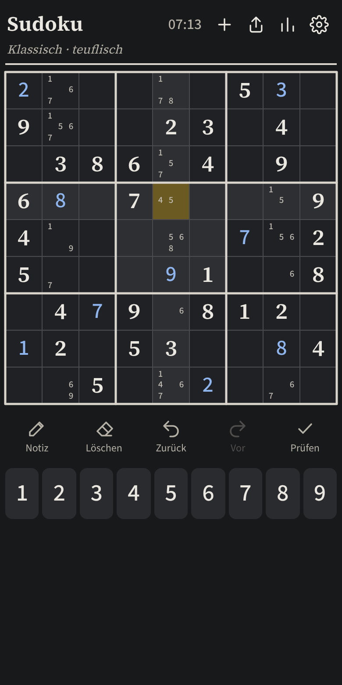

# Sudoku 🧩

Sudoku ist dein Rätselheft für die Momente, in denen „mittelschwer“ eine
Beleidigung ist: Killer-Sudoku ohne eine einzige vorgegebene Ziffer, nur
Käfige und ihre Summen, dazu klassische Sudokus, die erst mit X-Wing oder einer
Kette aufgehen. Gespielt wird auf dem Handy in der Bahn oder am Laptop mit der
Tastatur – jedes Rätsel hat genau eine Lösung, und jedes ist logisch lösbar,
ohne Raten.

Kurz gesagt: Die Rätselseite der Zeitung, nur ohne die leichten Rätsel.

**Einfach ausprobieren:** Unter
[sudoku.kanonenwiese.de](https://sudoku.kanonenwiese.de) läuft eine Instanz,
und wer mag, darf sie benutzen. **Kein Tracking, keine Werbung, kein Konto** –
die App schickt nichts an irgendwen, sie lädt nur sich selbst und ihre
Rätsel; was das im Einzelnen heißt, steht unter
[Kontakt & Datenschutz](https://sudoku.kanonenwiese.de/kontakt.html). Eine
Garantie, dass die Adresse für immer erreichbar bleibt, gibt es allerdings
nicht: Wenn du dich darauf verlassen willst, stell dir die App mit ein paar
Handgriffen selbst hin (siehe [Loslegen](#loslegen)).

| Killer auf dem Handy | Am Laptop mit Kombinationen | Klassisch, dunkel |
| --- | --- | --- |
|  |  |  |

## Was Sudoku für dich macht

- **Richtig schwere Rätsel** – drei Stufen, und die leichteste heißt
  „schwer“. Was sich mit Singles und einfachen Käfig-Kombinationen lösen
  lässt, ist gar nicht erst dabei. Bei „teuflisch“ brauchst du Ketten.
- **Ehrlich eingestuft** – jedes Rätsel hat ein Programm gelöst, das vorgeht
  wie du: erst die leichten Techniken, dann die schweren. Die Stufe richtet
  sich nach der schwersten Technik, die es gebraucht hat. Welche das sind,
  steht in [docs/schwierigkeit.md](docs/schwierigkeit.md).
- **Killer ohne Vorgaben** – ein leeres Gitter, gestrichelte Käfige, oben
  links die Summe. Keine Ziffer doppelt im Käfig, und die 45er-Regel ist dein
  bester Freund.
- **Klassisch, wenn du Abwechslung willst** – mit Vorgaben, punktsymmetrisch
  wie in der Zeitung.
- **Notizen, wie du sie magst** – Kandidaten von Hand setzen, mit dem
  Notizmodus oder per Shift auf der Tastatur. Mehrere Zellen markieren, und
  die Notiz landet in allen.
- **Hilfen nur, wenn du sie willst** – alle Kandidaten ausfüllen, Notizen
  automatisch streichen, mögliche Käfig-Kombinationen anzeigen, Fehler
  markieren. Jede Hilfe einzeln abschaltbar; ab Werk sind nur die Notizen an.
  Eine Hinweis- oder Löse-Taste gibt es nicht.
- **Ohne Angst vor Fehlern** – Rückgängig und Wiederholen ohne Grenze, auch
  für Notizen.
- **Dranbleiben** – der Spielstand wird bei jedem Zug gespeichert. App zu,
  Handy weg, morgen weiter. Der Timer läuft nur, solange du hinsiehst.
- **Wissen, wie gut du bist** – Statistik pro Spielart und Stufe: gelöst,
  Bestzeit, Durchschnitt, Serie.
- **Rätsel weitergeben** – ein Link, und dein Gegenüber hat genau dieses
  Rätsel vor sich. Das Rätsel steckt im Link selbst, ganz ohne Server.
- **Für sich bleiben** – kein Tracking, keine Werbung, kein Konto, keine
  fremden Server, nicht einmal für die Schriften. Spielstand, Einstellungen
  und Statistik liegen im Browser deines Geräts, und dort bleiben sie auch.
- **Offline dabeihaben** – Sudoku ist eine PWA. Einmal geöffnet, sind alle
  3.000 Rätsel auf dem Gerät, und es braucht kein Netz mehr.

## Für wen ist das?

Sudoku passt zu dir, wenn du ...

- bei Zeitungssudokus nach fünf Minuten fertig bist und dich ärgerst,
- Killer-Sudoku magst und bei „Innie“ und „Outie“ nicht an Bauchnabel denkst,
- lieber eine halbe Stunde an einem Rätsel sitzt als zehnmal kurz,
- unterwegs spielst und am Abend am Laptop weitermachen willst,
- keine App willst, die dich mit Werbung, Energie-Herzen oder Push-Meldungen
  bei der Stange hält.

## Loslegen

Sudoku ist eine statische Seite – kein Build, keine Abhängigkeiten, kein
Konto. Entweder du nimmst
[sudoku.kanonenwiese.de](https://sudoku.kanonenwiese.de), oder du kopierst dir
das Verzeichnis auf deinen eigenen Webspace und rufst die Adresse auf – mehr
braucht es nicht.

1. **Seite öffnen.** Beim ersten Mal fragt die App nach Spielart und Stufe.
   Fang ruhig mit „schwer“ an – schwer ist hier wirklich schwer.
2. **Zum Startbildschirm hinzufügen.** Im Browsermenü „Zum Startbildschirm“
   bzw. „App installieren“. Danach startet Sudoku wie eine App, im Vollbild
   und offline.
3. **In den Einstellungen umsehen.** Das Zahnrad oben rechts. Dort schaltest
   du die Hilfen ein, die du haben willst – oder eben nicht.

## Ein erster Rundgang

### 1. Ein Rätsel aussuchen

Das Plus oben rechts öffnet „Neues Rätsel“: Killer oder Klassisch, dann die
Stufe. Neben jeder Stufe steht, wie viele Rätsel du noch nicht gespielt hast.
Die App gibt dir immer ein neues, solange es welche gibt – erst wenn du alle
durch hast, kommen alte wieder.

### 2. Ziffern und Notizen setzen

Zelle antippen, Ziffer unten antippen. Noch einmal dieselbe Ziffer nimmt sie
wieder heraus. Mit **Notiz** wechselst du in den Notizmodus: Jetzt landen die
Ziffern klein in der Zelle, als Kandidaten.

Mehrere Zellen auf einmal? Mit dem Finger über das Gitter ziehen. Eine Ziffer
wird dann in allen markierten Zellen als Notiz gesetzt oder entfernt –
praktisch für einen Käfig, von dem du weißt, dass er 1 und 2 enthält.

### 3. Am Laptop: alles mit der Tastatur

| Taste | Wirkung |
| --- | --- |
| Pfeile oder WASD | Zelle wechseln, mit Shift die Auswahl erweitern |
| 1–9 | Ziffer setzen (im Notizmodus: Notiz) |
| Shift + Ziffer | Notiz direkt setzen |
| Leertaste | Notizmodus an/aus |
| Backspace / Entf | Löschen |
| Strg+Z / Strg+Y | Rückgängig / Wiederholen |
| Shift-/Strg-Klick, Ziehen | mehrere Zellen wählen |
| K | Käfig-Kombinationen ein/aus |
| N | neues Rätsel |
| ? | Tastenübersicht |

Die Übersicht steht auch in der App, unten im Seitenpanel unter
„Tastenkürzel“.

### 4. Fehler finden – oder lieber nicht

Ab Werk verrät dir die App nichts. Wenn du wissen willst, ob du dich
verrannt hast, tippst du auf **Prüfen**: Falsche Ziffern werden markiert, bis
du weiterspielst.

In den Einstellungen kannst du die Fehleranzeige dauerhaft einschalten, in
zwei Stärken:

- **Regelkonflikte** markiert, was du auch selbst sehen könntest: eine Ziffer
  doppelt in Zeile, Spalte, Block oder Käfig, eine überschrittene Käfigsumme,
  ein voller Käfig mit falscher Summe. Die Lösung verrät das nicht, deshalb
  zählt so ein Rätsel ganz normal.
- **Gegen die Lösung** markiert jede falsche Ziffer sofort. Das ist eine echte
  Hilfe – so gelöste Rätsel zählen in der Statistik getrennt.

### 5. Käfig-Kombinationen

Bei Killer-Rätseln sitzt in der Werkzeugleiste der Knopf **Kombis** (am
Laptop auch die Taste K). Ist er an, zeigt die App zum gewählten Käfig alle
Ziffernkombinationen, die zur Summe und Größe passen – ein Tipp, und das Panel
ist wieder weg, wenn du es lieber selbst rechnen willst. Der Knopf und der
Schalter in den Einstellungen sind dieselbe Einstellung.
Das Panel steht unter dem Ziffernfeld, damit beim Ein- und Ausblenden nichts
verrutscht. Kombinationen, die durch gesetzte Ziffern nicht mehr gehen, sind
grau durchgestrichen. Und was du selbst ausgeschlossen hast – etwa weil die 9
in diesem Käfig keinen Platz mehr hat –, tippst du einfach an: Die Kombination
wird gestrichelt durchgestrichen, ein zweiter Tipp holt sie zurück. Deine
Streichungen gehören zum Spielstand und sind nach einem Neustart noch da.
Welche Schlüsse du daraus ziehst, bleibt deine Sache.

### 6. Käfige zusammenrechnen

Markierst du mehrere Käfige vollständig – mit dem Finger darüberziehen oder
am Laptop mit Strg-Klick –, steht unter „Sudoku“ (am Laptop im Seitenpanel),
wie viele Käfige und Zellen das sind und wie groß ihre Summe ist, etwa
„3 Käfige · 9 Zellen · Summe 52“. Praktisch für die 45er-Regel: Zieh die
Käfige eines Blocks zusammen, und du siehst sofort, was für die übrigen
Zellen bleibt. Fehlt eine Zelle oder ist eine zu viel dabei, verschwindet die
Angabe wieder.

### 7. Teilen

Das Pfeil-Symbol oben teilt das aktuelle Rätsel: auf dem Handy über das
normale Teilen-Menü, am Laptop wird der Link kopiert. Wer ihn öffnet, startet
genau dieses Rätsel – auch wenn es in seiner App gar nicht vorkommt.

## Was Sudoku *nicht* kann

- **Keine Hinweise, keine Lösung auf Knopfdruck.** Absicht.
- **Kein Konto, kein Abgleich zwischen Geräten.** Handy und Laptop führen
  jeweils ihre eigene Statistik.
- **Keine Tagesrätsel, keine Ranglisten.**
- **Noch keine weiteren Varianten.** Sudoku X und Killer X sind vorbereitet
  (Regeln und Löser arbeiten mit einem Constraint-Modell), aber noch nicht
  spielbar.

## Mehr dazu

| Thema | Wo |
| --- | --- |
| Welche Technik in welche Stufe gehört | [docs/schwierigkeit.md](docs/schwierigkeit.md) |
| Wie ein Rätsel in einen Link passt | [docs/format.md](docs/format.md) |
| Wie die App auf den Webspace kommt | [DEPLOYMENT.md](DEPLOYMENT.md) |

## Technische Doku

### Aufbau

```
index.html              die App (eine Seite, Dialoge als <dialog>)
kontakt.html            Kontakt & Datenschutz
css/app.css             Gestaltung, hell und dunkel
fonts/                  Source Serif 4 und Source Sans 3 (OFL), lokal
js/core/                gemeinsamer Kern für Browser, Generator und Tests:
  model.js                Constraint-Modell (Häuser, Käfige)
  variants.js             Varianten und Stufen
  solve.js                Backtracking, Eindeutigkeit
  human/                  menschlicher Löser: Techniken und Bewertung
  conflicts.js            Regelkonflikte
  combos.js               Käfig-Kombinationen
  codec.js                Rätsel-Code für Links und Bank, stabile ID
js/ui/                  Oberfläche: Gitter, Spielstand, Bank, Statistik, App
data/                   Rätselbank, je Spielart und Stufe 500 Rätsel
sw.js                   Service Worker: lädt alles vor, Netz zuerst
manifest.webmanifest    PWA-Manifest
icons/                  Icons, erzeugt aus icon.svg (scripts/make-icons.cjs)
tools/                  Generator und Bankprüfung (Node, wird nicht hochgeladen)
tests/                  Tests mit node:test (wird nicht hochgeladen)
```

Kein Build, keine Abhängigkeiten zur Laufzeit. Vanilla JavaScript mit
ES-Modulen, damit derselbe Kern im Browser und in Node läuft.

### Tests und Rätselbank

```bash
npm test                                            # alle Tests
node tools/generate.mjs --variant killer --count 500  # Bank auffüllen
node tools/check-bank.mjs                           # ganze Bank prüfen
```

Die Tests prüfen jede Technik an einem handgebauten Muster, die
Eindeutigkeit, die Konfliktprüfung, das Kodieren und Dekodieren der Links,
die Stufe bekannter Rätsel und eine Stichprobe jeder Bankdatei. Die CI
erzeugt keine Rätsel; die Bank liegt fertig im Repo.

### Aufspielen

Jeder Push auf `main` lässt die Tests laufen und spiegelt das Repo danach per
SFTP auf den Webspace – wie das eingerichtet wird, steht in
[DEPLOYMENT.md](DEPLOYMENT.md). Von Hand geht es genauso: das Verzeichnis
kopieren, ohne `tools/`, `tests/`, `docs/` und `scripts/`. Alle Pfade sind
relativ, die App läuft also in jedem Unterordner.

In `kontakt.html` stehe ich als Verantwortlicher. Stellst du die App
öffentlich hin, gehört dort dein Name hin, nicht meiner.

Neue Fassungen kommen still: Der Service Worker holt alles „Netz zuerst“ und
tauscht seinen Cache beim nächsten Besuch aus, ohne Meldung. Welche Version
läuft, steht in den Einstellungen ganz unten (`x.yy.zzz`, siehe
`versions.json`).

### Nicht im Index

Sudoku soll nicht über Suchmaschinen gefunden werden. Dafür stehen
`noindex, nofollow` in jeder Seite, ein `X-Robots-Tag`-Header in `.htaccess`
und `Disallow: /` in `robots.txt`. Das ist höflich, nicht sicher – wer sich
nicht daran hält, hält sich nicht daran.

### Stand

- [x] Killer-Sudoku ohne Vorgaben und klassisches Sudoku
- [x] Je 500 Rätsel in drei Stufen, eindeutig und logisch lösbar
- [x] Bewertung über einen menschlich vorgehenden Löser
- [x] Notizen, Mehrfachauswahl, Undo/Redo ohne Grenze
- [x] Volle Tastaturbedienung mit Übersicht
- [x] Hilfen einzeln abschaltbar: Kandidaten, Streichen, Kombinationen, Fehleranzeige in drei Stufen
- [x] Timer mit Pause im Hintergrund, Statistik mit Serie, getrennte Zählung mit Hilfen
- [x] Teilen per Link ohne Server
- [x] Hell, dunkel oder wie das System
- [x] Offline spielbar, installierbar, stille Updates
- [x] Kontakt und Datenschutz, noindex und robots.txt
- [ ] Sudoku X und Killer X

## Lizenz

[MIT](LICENSE)

Die Schriften Source Serif 4 und Source Sans 3 stehen unter der
[SIL Open Font License](fonts/OFL.txt). Sonst ist kein fremder Code
enthalten: keine Bibliotheken, kein Build-Schritt.
